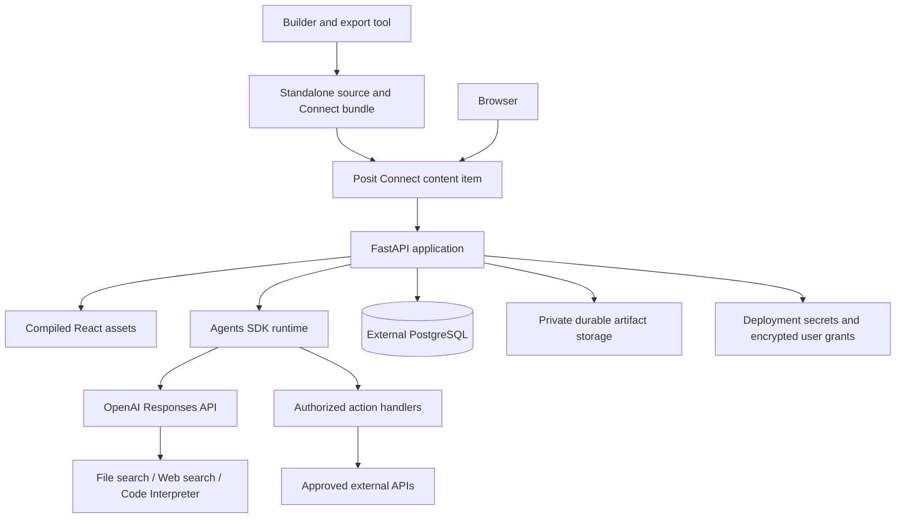

# Standalone Chat Agent on Posit Connect — Product and Deployment Specification

**Status:** Proposed implementation baseline  
**Version:** 1.0  
**Date:** October 7, 2026  
**Parent:** [Configurable GPT Builder](spec.md)  
**Actions contract:** [Actions specification](actions-spec.md)

## 1. Objective and binding decisions

The builder must generate a standalone project for each configured assistant. Each project contains an editable React frontend, a Python FastAPI backend, the selected assistant configuration, supported action implementations, knowledge provisioning instructions, and a deployment bundle suitable for Posit Connect.

The deployed agent must work with the builder shut down and with no access to the builder's database or filesystem. It still requires OpenAI and the external services configured for that deployment. Standalone means independent of the builder, not offline model inference.

The user has selected:

- A ChatGPT-style chat frontend built with HTML/CSS/JavaScript through React.
- A Python backend using the OpenAI Agents SDK and Responses API.
- Posit Connect as the hosting destination.
- Independently deployable projects rather than assistants accessible only inside a shared builder platform.

This specification makes those decisions concrete. It governs deployment, exported-project behavior, Connect identity, URL handling, and process lifecycle where earlier generic assumptions differ. The parent remains authoritative for agent capabilities and the Actions companion for schema/execution semantics.

**Completion condition:** Export a configured agent, deploy it as a Connect content item, stop the builder, and verify that authorized Connect users can independently chat, retrieve knowledge, use enabled tools, connect external accounts, and download artifacts. History survives application restart and redeployment.

## 2. Scope and prerequisites

### 2.1 Target environment

Target an organization-managed Posit Connect server. Connect Cloud is a distinct deployment profile and is not assumed. The reviewed Posit documentation is version 2026.09.0; the user's actual server version, license entitlements, Python installations, and network policy have not been inspected.

Before implementation release, verify that the target installation supports FastAPI/ASGI content, the chosen Python version and packages, authenticated access, outbound OpenAI access, external PostgreSQL, and the required artifact storage. FastAPI publication is documented by Posit. [P1]

### 2.2 Required release scope

| Area | Required result |
| --- | --- |
| Builder export | Downloadable standalone source project and deterministic deployment bundle |
| Frontend | Complete chat application with the agreed ChatGPT-style layout and interactions |
| Runtime | One FastAPI content item serving both React assets and application APIs |
| Agent behavior | Instructions, knowledge, actions, web search, code generation, optional Python execution |
| Identity | Connect-authenticated viewers with private per-user conversations and grants |
| Persistence | External PostgreSQL and approved durable artifact storage |
| Deployment | Documented `rsconnect-python` workflow; pinned dependencies and explicit entrypoint |
| Recovery | Durable pauses, stream replay, failure reporting, and no blind replay of external writes |
| Operations | Secrets, runtime configuration, upgrades, rollback, cleanup, and acceptance evidence |

Public anonymous access, a public marketplace, a second hosted frontend service, React server-side rendering, continuous unattended execution, automated changes to Connect permissions, and deployment to arbitrary cloud providers are outside the first release.

A Docker image or Compose file may be a local-development convenience. It is not the required Connect publication mechanism. No container orchestration privileges are required by the generated application.

## 3. Builder and deployed runtime boundaries

### 3.1 Two applications

| Responsibility | Builder | Exported chat application |
| --- | --- | --- |
| Configure instructions, knowledge, actions | Yes | Read-only released configuration |
| Preview a draft | Yes | No draft UI |
| Publish an immutable release | Yes | Load deployed release |
| Export project | Yes | Not required |
| Chat and run tools | Preview only | Yes, for authorized viewers |
| User conversations and OAuth grants | Separate preview state | Deployment-owned persistent state |
| Dependency on builder availability | Not applicable | None |

The exported application must not include enabled builder/admin mutation routes. Configuration changes normally require a new release and redeployment. Restricted operator provisioning commands are separate from viewer APIs.

### 3.2 Release versus deployment

**PC-01:** Publishing in the builder validates and freezes an assistant release. Export packages that release with a versioned runtime template. Deployment is a separate action that installs the package on Connect. None of these actions silently performs the next step.

**PC-02:** Record assistant release ID, configuration schema version, runtime template version, compiler version, dependency lock information, knowledge manifest hash, and build identifier. Use content hashes to detect corrupted/mismatched package files; do not describe hashes alone as proof of trusted authorship.

**PC-03:** The same exported source can be deployed to separate installations with different database, storage, OpenAI project, and credential settings. Each installation receives an operator-controlled unique namespace. Imported builder IDs do not establish authorization or map automatically to production credentials.

### 3.3 Revocation boundaries

Deleting an assistant or knowledge file in the builder affects that builder's state. It cannot revoke an already exported, independent installation without a separate authorized management action. The UI must state this clearly.

Production revocation occurs at the deployed application's resource controls, deployment configuration, provider credential revocation, or Connect access settings. No hidden callback to the builder is permitted merely to simulate global revocation. A future centralized fleet-management feature needs its own explicit contract.

## 4. Runtime architecture



**PC-04:** Deploy one FastAPI ASGI application per exported agent. It owns `/`, static assets, and `/api/v1/...` beneath the Connect-assigned application prefix. Define the root HTML route explicitly. Posit documents FastAPI HTML/static delivery and Python deployment through an application entrypoint. [P1], [P2]

The backend uses the Agents SDK's Responses integration for the agent loop. Retain the parent's function tool, knowledge, and Python execution boundaries. Never execute generated code in the Connect application process; Python analysis remains in the configured hosted execution environment.

The deployment includes source and assets needed at runtime. It must not fetch Python modules or frontend code from the builder on startup. Routine startup must not recreate vector stores, re-upload the knowledge corpus, or run database schema migrations concurrently in every worker.

## 5. Exported project and packaging contract

### 5.1 Required project layout

The layout below is a proposed deliverable, not a claim that the implementation already exists.

```text
my-agent/
├── frontend/
│   ├── src/
│   ├── public/
│   ├── package.json
│   ├── package-lock.json
│   └── vite.config.ts
├── backend/
│   ├── app.py
│   ├── agent.py
│   ├── actions.py
│   ├── identity.py
│   ├── persistence.py
│   └── requirements.txt
├── assistant/
│   ├── config.json
│   ├── instructions.md
│   ├── actions/
│   └── knowledge-manifest.json
├── knowledge-sources/         # Authorized originals for provisioning, when included
├── migrations/
├── scripts/
│   ├── package.py
│   ├── provision.py
│   └── verify_bundle.py
├── deploy/                   # Generated, ready-to-publish directory
│   ├── app.py
│   ├── runtime/              # Packaged backend modules
│   ├── assistant/            # Nonsecret released configuration
│   ├── web/
│   │   ├── index.html
│   │   └── assets/
│   ├── requirements.txt
│   ├── release.json
│   └── manifest.json         # Generated by rsconnect tooling when used
├── .env.example              # Names/placeholders only
├── .gitignore
└── README.md
```

Files may be combined when the implementation stays clear. Export may not omit required runtime logic simply because it exists in the builder repository.

**PC-05:** Produce a downloadable ZIP or project folder containing editable source, an exact assistant snapshot, pinned dependencies, build/provisioning scripts, deployment instructions, and a file inventory. Bind export to an expected release ID to prevent concurrent edits from producing mixed versions.

**PC-06:** Build React before publication. Node.js is a build-time dependency only for this profile. Compile assets into `deploy/web`; serve the index at the application root and the asset directory through explicit static routes. Do not expose the entire deployment directory as public files.

**PC-07:** Assemble the deploy directory from an explicit allowlist. Exclude `.env`, API tokens, OAuth grants/client secrets, database dumps, chat histories, local credentials, `.git`, `node_modules`, virtual environments, caches, and unnecessary source maps. Do not interpolate instructions or action secrets into frontend bundles.

**PC-08:** Export the knowledge manifest and authorized source files or approved retrieval instructions for those files. Provisioning uploads into the target OpenAI project and saves target resource mappings to deployment storage. Builder-side file/vector-store IDs are not assumed portable. Provisioning must be idempotent and report partial failure without marking an incomplete corpus ready.

Knowledge originals are not automatically served to all viewers. The operator explicitly selects the corpus shared by the deployed agent; sources requiring different document-level access policies need per-user retrieval authorization before sharing the content item. Application conversation isolation does not create document-level permissions by itself.

### 5.2 Release descriptor

Example application metadata; placeholders are not provider API identifiers:

```json
{
  "schema_version": 1,
  "assistant_release_id": "release_example_3",
  "template_version": "1.0.0",
  "action_compiler_version": "1.0.0",
  "target": "posit-connect-fastapi",
  "entrypoint": "app:app",
  "frontend_mode": "react-static",
  "required_settings": [
    "OPENAI_API_KEY",
    "OPENAI_MODEL",
    "DATABASE_URL",
    "APP_INSTANCE_ID",
    "APP_PUBLIC_BASE_URL",
    "CONNECTION_ENCRYPTION_KEY"
  ],
  "artifact_storage": "operator-configured",
  "knowledge_provisioning_required": true
}
```

The release must carry a permitted model contract. `OPENAI_MODEL` can select a deployment-approved compatible model, but a change is an explicit operator override recorded with each run; unsupported tool combinations fail validation. It does not allow chat users to submit arbitrary model IDs.

## 6. React chat UI contract

**PC-09:** Provide a complete chat interface: collapsible history sidebar, New chat, assistant identity, conversation starters, scrolling message column, fixed composer, multiline input, attachments, streaming text, Markdown/tables, code copy/download, citations, tool progress, approvals, Connect account actions, and artifact downloads.

Use a reference screenshot agreed during UI implementation to verify layout, typography, spacing, composer placement, sidebar behavior, and light/dark themes. The user's request for a ChatGPT-like experience is a visual/interaction target, not an assertion that every ChatGPT feature is included. Voice, canvas, image generation, and public sharing remain outside this release.

**PC-10:** Support desktop and mobile layouts, keyboard interaction, labeled controls, focus restoration after dialogs, readable contrast, and nonintrusive streaming announcements. Use the exported assistant's own name/avatar. Do not invent unavailable controls or expose model/provider errors as raw tracebacks.

**PC-11:** A viewer sees only their conversations. Chat history, uploaded analysis files, approvals, and OAuth accounts are scoped to the current installation and authenticated user. Switching users must clear cached frontend state before displaying server data.

Do not place secrets or sensitive transcripts in browser local storage by default. UI preferences such as theme may be stored locally. Do not cache authenticated responses through a service worker in the first release.

## 7. Connect URL prefixes, routing, and assets

Connect applications live behind a proxy and may be served under a prefix. Posit documents `rstudio-connect-app-base-url` for discovering the application's base URL. [P1]

**PC-12:** Treat the application base URL as a first-class runtime value. Use an operator-configured canonical `APP_PUBLIC_BASE_URL` including any path prefix for OAuth and absolute URLs. Validate request-derived Connect base information against approved origin/path settings; do not trust arbitrary Host/Forwarded headers from an untrusted connection.

Normalize the base with one trailing slash. Resolve application-relative API, asset, download, and callback paths against it. A leading `/api/v1` in browser code points at the Connect host root and is incorrect for a prefixed deployment. Avoid adding the prefix twice when ASGI `root_path` already represents it.

**PC-13:** Use hash-based client navigation initially, for example `<app-base>/#/c/<conversation-id>`, to avoid server deep-link rewrites. Configure relative frontend assets and test base-path resolution from the root, chat navigation, reload, and OAuth completion. A later history-router implementation requires explicit rewrite and fallback tests.

Server routing order must preserve API semantics: API and assets are explicit routes; unknown API endpoints return JSON `404`, and missing JavaScript files return `404`, not `index.html` with a misleading `200`. Serve only known frontend assets, never backend files, manifests with sensitive metadata, or instruction documents.

**PC-14:** Add `GET /api/v1/bootstrap` returning safe assistant identity, enabled presentation capabilities, release/build ID, canonical application base, current-user display information, and CSRF bootstrap information. It must not return instructions, tool secrets, database settings, provider keys, or other users' state. Serialize bootstrap content safely rather than injecting unescaped strings into HTML.

## 8. Connect identity and user authorization

Connect can deliver user/group metadata to content through `RStudio-Connect-Credentials`; identity representation and uniqueness depend on administrator settings. [P1], [P6]

**PC-15:** Use Connect-authenticated access for the production content item. The backend parses the trusted metadata through one identity adapter and maps it to an internal user ID. Missing, malformed, or anonymous metadata fails closed for chat and protected resource routes. The development identity adapter is explicitly local-only and disabled in the Connect profile.

Ensure traffic reaches the application only through the trusted Connect boundary. Verify the deployed proxy prevents client-spoofed identity metadata from becoming authoritative; header presence alone is not proof of authentication. Do not expose a separate public Uvicorn port bypassing Connect.

**PC-16:** Prefer an administrator-configured stable unique identity. If only usernames are available, document and verify server-wide uniqueness and rename/reassignment behavior. Do not assume display names, emails, or group names are immutable identifiers. Map identity using a Connect-installation namespace and a uniqueness-approved subject.

Application viewers do not gain access to another viewer's conversations or credentials. Connect publisher/collaborator roles do not automatically become application-data reader roles. Nevertheless, people able to modify the deployed backend and its secrets are trusted operators; row-level UI checks do not protect data against malicious deployment administrators.

**PC-17:** Keep application login separate from external-service OAuth. Connect access authorizes entry to the app, not access to Salesforce, a ticketing API, or another user's external account. Each user connects their own OAuth account. Recheck user/installation ownership at every action, approval, resume, and download.

For API-key actions, default to per-user credentials or an explicitly configured service identity. A service identity must be deliberately provisioned by the operator with a documented permitted audience and scope. Never export and reuse the builder owner's personal key as the default for every Connect viewer.

**PC-18:** Apply same-origin mutation checks and CSRF protection compatible with Connect sessions. Do not reimplement Connect login or expose Connect deployment API keys in the browser. Scope any application cookies to the content path where supported and give them deployment-specific names to avoid collisions with other content on the same host.

Access removal must deny subsequent requests. An already dispatched external request cannot be retroactively undone; do not promise that removing a viewer cancels every remote effect instantaneously. Long-lived streams must honor application session expiry and reconnect policy.

## 9. Secrets and environment configuration

Connect provides content-level environment-variable configuration; Posit recommends keeping secrets out of code. [P3]

**PC-19:** Read deployment secrets from Connect environment settings or an administrator-approved secret integration. OAuth access/refresh tokens are per-user records stored encrypted in PostgreSQL or a secret store; they are not one shared process environment variable.

| Setting | Purpose | Secret? |
| --- | --- | --- |
| `OPENAI_API_KEY` | OpenAI API access for this deployment | Yes |
| `OPENAI_MODEL` | Explicit compatible deployment model | No |
| `DATABASE_URL` | PostgreSQL connection information | Usually |
| `APP_INSTANCE_ID` | Stable isolation namespace, distinct between independent deployments | No |
| `APP_PUBLIC_BASE_URL` | Canonical HTTPS content URL including prefix | No |
| `IDENTITY_MODE` | `posit_connect` in production; explicit development mode locally | No |
| `CONNECT_IDENTITY_NAMESPACE` | Identifier for the trusted Connect installation | No |
| `CONNECTION_ENCRYPTION_KEY` | Encryption key for stored credentials/state | Yes |
| `ARTIFACT_STORAGE_URI` | Approved private storage location/prefix | Usually no |
| Storage credentials | Access to the configured artifact store, preferably managed identity | Yes |
| Runtime limit settings | Time, concurrency, upload, action, and spend limits | No |

The packaging/provisioning README must list conditional settings for chosen storage and OAuth providers. Do not use the publisher's Connect API key as a runtime identity or as an external action key. Disable sensitive request-body logging and review tracing policy before using production documents.

For first deployment, create/configure content and environment settings before making it available to viewers. Missing required secrets produce an unavailable/not-ready state, not an anonymous fallback or a partially configured assistant. Do not paste secrets into generated commands or commit them to the bundle.

## 10. Persistence and resource lifecycle

Posit warns that deployment working directories are not durable storage and that multiple content processes do not coordinate file writes automatically. [P4]

**PC-20:** Store conversations, SDK session items, events, approvals, grants, resource mappings, and job/execution state in external PostgreSQL. Use `APP_INSTANCE_ID` in every ownership boundary when infrastructure is shared across deployments. Schema separation or separate databases may strengthen isolation.

**PC-21:** Save durable uploaded files and artifacts in approved private object storage or administrator-provisioned persistent storage. The deploy directory is read-only application material by design, even if the server permits writes. Temporary files use an explicit scratch directory and are never the only copy of required data.

**PC-22:** Preserve an installation's instance ID, database, storage prefix, and resource mappings when updating the same agent. A new independent agent deployment must receive a new namespace and credentials/bindings. A copied content item must not silently open the original application's conversations.

Do not use a local SQLite file in the content bundle, in-memory session dictionaries, or a shared mutable file as the production source of truth. Use database transactions for conversation/run ownership and job claims. Session affinity may improve routing but is not a persistence guarantee.

**PC-23:** Register each activated release in the deployment database. Retain immutable configuration/tool mappings needed by existing conversations while they are supported. New chats use the active release; older chats remain pinned. If a new runtime cannot safely support an older tool/compiler/state format, block execution of that old conversation with a clear migration/new-chat path rather than silently changing behavior.

Retention and deletions follow the parent policy within this installation. Purging expired artifacts while the app is asleep requires a documented maintenance trigger. Use an operator-run maintenance command initially; do not claim an in-app timer will meet a wall-clock cleanup SLA when no process exists.

## 11. Streaming, execution, and process recovery

Connect may start, scale, and terminate application processes according to its scheduler and content runtime settings. [P5]

### 11.1 Interactive execution profile

**PC-24:** The initial profile supports interactive chat with persisted state and best-effort continuation during short connection interruptions. It does not guarantee uninterrupted processing after all clients disconnect or Connect terminates a worker. This qualifies the parent's generic background-run assumption.

`POST /conversations/{id}/runs` atomically creates an idempotent run and starts or queues execution under a database lease. `GET /runs/{id}/events` observes persisted events; it does not approve/resume a paused action. A process-local asynchronous task may perform the run, but must never be the sole record of its existence or progress.

Keep the active stream open during ordinary execution. Persist text/tool items and checkpoints at supported boundaries. Complete a model/tool result transaction before reporting it as durable. If a process dies without a safe checkpoint, preserve the partial answer and report `failed` with `run_interrupted`; do not reconstruct the original request and repeat effects automatically.

### 11.2 SSE transport

**PC-25:** Implement SSE using the existing run/event contract, event sequence replay, and idempotent client rendering. Send periodic comment heartbeats during quiet model/tool periods; use a configurable initial interval of 15 seconds. Heartbeats do not increment conversation content or falsely indicate model progress.

Test buffering, compression, connection/read timeouts, load balancer behavior, and Connect session expiry on the actual deployment. An application header alone does not guarantee every upstream proxy flushes events. Set content/proxy timeouts appropriately with the administrator; do not disable every timeout by default. Connect exposes separate runtime timeout controls. [P3]

Authenticate SSE like other app routes. An expired login may produce an HTML redirect at the Connect layer; the frontend must identify an authentication interruption and reauthenticate instead of parsing HTML as an event stream. Do not put keys or tokens in event URLs.

### 11.3 Multiple workers and durable pauses

**PC-26:** Use transactional claims, leases, and fencing/version checks for run ownership and refresh locks. Another worker may serve SSE or resume a paused run using database state. Validate exactly one unfinished run per conversation across processes. Never dispatch a second write because a worker lease expired after the first worker started dispatch.

**PC-27:** Persist approval and connection pauses, expiration timestamps, SDK state version, tool-call identity, argument hashes, and required credential bindings before returning the prompt to the UI. These pauses must survive worker shutdown. On explicit resume, recheck current user, policy, resources, and credential identity. Do not keep a database connection or worker thread blocked while a person decides.

**PC-28:** At startup and subsequent maintenance/reconciliation points, classify stale work: safely queued work may be claimed; supported paused work remains resumable; ambiguous dispatched writes become `outcome_unknown`; unsupported interrupted state becomes a visible failure. Late results are reconciled against execution identity rather than blindly overwriting newer state.

### 11.4 When a separate worker becomes necessary

An independently managed worker is required if the product later promises completion while users are offline, scheduled unattended execution, or strict cleanup deadlines. It can reuse the same database-backed job contract, but must have its own approved execution lifecycle. Setting a generous idle timeout does not create a durable worker service. This infrastructure is deferred until that promise is required.

## 12. OAuth under the Connect URL

**PC-29:** Form OAuth callbacks from `APP_PUBLIC_BASE_URL` plus the application's callback path, including its content prefix. Register that exact URL with each provider. Do not use a builder callback, ChatGPT callback, guessed hostname, or a host-root path that drops the content prefix.

The callback remains covered by the Actions state/PKCE/session rules. Because it is a browser redirect to protected Connect content, verify that a signed-in viewer can complete it and that reauthentication preserves or safely restarts the transaction. Test popup and full-page flows; choose full-page redirect as the default if proxy/cookie behavior makes popups unreliable.

Changing the canonical app URL or cloning content may require registering a new callback and reconnecting grants. It must not silently reuse an OAuth grant scoped to a different installation. Strip callback query parameters from displayed navigation immediately after secure exchange and prevent their collection in application logs/analytics.

## 13. Export and runtime API additions

Reuse parent APIs with a clear surface split:

| Route | Surface | Contract |
| --- | --- | --- |
| `POST /assistants/{id}/publish` | Builder | Validate and freeze a release; no deployment |
| `POST /assistants/{id}/exports` | Builder | Explicit release ID and target `posit-connect-fastapi`; return export job |
| `GET /exports/{id}` | Builder | Status, release/template versions, safe errors |
| `GET /exports/{id}/download` | Builder | Authorized source/bundle download; never includes secrets |
| `GET /api/v1/bootstrap` | Deployed app | Safe UI and identity configuration |
| Conversation/run/attachment APIs | Deployed app | Parent semantics within this installation |
| OAuth start/callback/connection APIs | Deployed app | Current user's connection lifecycle |
| Credential provisioning | Operator command or narrowly authorized endpoint | Cannot be changed by ordinary viewers |
| `/healthz` and `/readyz` | Deployed app | Minimal health/readiness; no secrets or paid model requests |

Builder routes in this table use the parent's `/api/v1` prefix. Deployed routes are relative to the application's Connect base, not the host root. Do not expose builder schema import, configuration editing, publishing, or export endpoints to deployed chat viewers.

## 14. Build and deployment workflow

**PC-30:** Supply a documented build pipeline that produces a clean deploy directory from pinned source and the selected release:

1. Validate configuration, export eligibility, schemas, and declared secret requirements.
2. Install frontend dependencies from the lockfile; build production assets.
3. Package backend modules, configuration, assets, and pinned Python requirements.
4. Validate the bundle inventory and reject missing assets, unsafe paths, or bundled secrets.
5. Generate Connect deployment metadata using supported tooling when a manifest is needed.
6. Provision target storage/database/knowledge through an explicit operator step.
7. Publish to Connect, configure the canonical URL and secrets, and run acceptance checks before enabling viewers.

Illustrative commands, to be implemented/documented by the generated project:

```text
# From frontend/; Node is used only during the build.
npm ci
npm run build

# From the exported project root; these scripts are implementation deliverables.
python scripts/package.py
python scripts/verify_bundle.py

# With an authenticated saved rsconnect server profile named myServer.
rsconnect deploy fastapi -n myServer --entrypoint app:app ./deploy
```

`app.py` in the deployment root must expose `app`. For manifest-based publication, generate the manifest from the assembled deploy directory and a clean compatible Python environment; avoid accidentally capturing the builder's unrelated dependencies. Posit documents the CLI entrypoint and `write-manifest` workflow. [P2]

Do not publish from the entire authoring workspace. Deployment credentials remain on the operator's workstation/CI or approved Connect publishing mechanism. The export process must not deploy, change access permissions, or send invitations as a side effect.

### 14.1 Operator preflight

- Record Connect version, supported Python version, FastAPI capability, package index access, and TLS/proxy configuration.
- Verify network routes to OpenAI, PostgreSQL, storage, approved action destinations, and OAuth endpoints.
- Provision independent application namespace, secrets, and service identities where intentional.
- Validate migrations and knowledge ingestion separately from serving requests.
- Configure viewer access through Connect and verify the trusted identity contract.
- Verify the canonical content URL, asset paths, callback registrations, and SSE delivery.
- Record process/timeouts and resource limits; start with the smallest measured configuration that meets expected load.

This is an implementation/deployment readiness list, not a request to change the user's Connect server now.

## 15. Upgrades, rollback, and observability

**PC-31:** Treat application-code deployment, database migration, and external-resource provisioning as separate controlled steps. Use backward-compatible migrations before code activation where possible. Only one migration operation may run per installation; never run destructive migrations in each ASGI startup.

A rollback restores a compatible earlier bundle and active release pointer. It does not automatically roll back the database, recover deleted files, revoke new tokens, or undo API actions. Preserve prior release mappings and test compatibility before offering rollback. Block unsupported downgrades with a clear explanation.

**PC-32:** Expose safe release/build identity and operational metrics: active/interrupted runs, pending approvals/connections, stale leases, indexing/provisioning failures, artifact-copy failures, cleanup backlog, external unknown outcomes, and usage. Include request/run/installation IDs in redacted logs. Health probes must not call a paid model or enumerate user data.

A redeploy must preserve existing conversations, private grants, artifacts within retention, and pending pauses compatible with the new runtime. If pending SDK state is incompatible, drain or explicitly terminate those pauses before deployment; do not discover the incompatibility by sending a duplicate external request.

## 16. Acceptance criteria

Perform local deterministic tests and a dedicated staging Connect deployment. Record the actual Connect/runtime/proxy settings used; a localhost-only test cannot certify Connect routing, identity, or streaming.

| ID | Scenario | Pass condition |
| --- | --- | --- |
| PC-AC-01 | Independent export | Exported source and bundle run with builder unavailable and no builder database access |
| PC-AC-02 | Full bundle | Backend, assets, config, action logic, locks, and provisioning instructions are present |
| PC-AC-03 | Secret exclusion | Bundle, ZIP, browser assets, and manifests contain no credentials or private history |
| PC-AC-04 | Connect entrypoint | Published content loads the chat UI at its actual content URL through `app:app` |
| PC-AC-05 | Prefix routing | Assets, API calls, downloads, reloads, and hash chat links work under a non-root prefix |
| PC-AC-06 | Routing errors | Missing API/assets return appropriate errors rather than the SPA index |
| PC-AC-07 | Identity boundary | Missing/malformed/spoofed identity fails; only the trusted Connect path authenticates |
| PC-AC-08 | Viewer isolation | Two authorized viewers cannot read each other's chats, uploads, grants, approvals, or events |
| PC-AC-09 | Namespace isolation | Two deployments sharing infrastructure cannot access each other's data |
| PC-AC-10 | Access removal | Revoked viewers cannot make subsequent protected requests |
| PC-AC-11 | User interface | Agreed desktop/mobile visual reference and keyboard flows pass review |
| PC-AC-12 | All enabled capabilities | Knowledge, web search, code output, Python artifacts, and API actions work in staging |
| PC-AC-13 | Knowledge provisioning | Target project receives the corpus once; rerunning provisioning is safe |
| PC-AC-14 | Knowledge audience | Shared corpus is deliberate; restricted documents cannot leak through an unauthorized agent |
| PC-AC-15 | SSE and proxy | Incremental events arrive before completion under actual proxy/timeouts |
| PC-AC-16 | Reconnect | Events replay without duplicate messages or new runs |
| PC-AC-17 | Connect login expiry | Frontend recognizes auth interruption rather than displaying HTML as model output |
| PC-AC-18 | Multi-process behavior | State survives worker changes; concurrent sends do not create duplicate runs/actions |
| PC-AC-19 | Idle/process termination | History remains; interrupted runs report accurately; uncertain writes are not replayed |
| PC-AC-20 | Durable approval | Pause survives restart and resumes once with revalidated identity/arguments |
| PC-AC-21 | OAuth callback | Exact prefixed URL works, including reauthentication and safe transaction expiry |
| PC-AC-22 | OAuth user isolation | Tokens refresh/disconnect per user and installation without cross-user access |
| PC-AC-23 | Redeployment | Database history, storage artifacts, and compatible pauses survive new bundle activation |
| PC-AC-24 | Rollback | Compatible earlier bundle works; incompatible migration/state rollback is blocked |
| PC-AC-25 | Storage durability | No required data depends on the deployment working directory |
| PC-AC-26 | Secret configuration | Missing settings fail readiness; no secrets appear in logs, bootstrap, traces, or browser storage |
| PC-AC-27 | Export revocation semantics | Builder deletion is not falsely advertised as remote deletion; deployed revocation works locally |
| PC-AC-28 | Maintenance | Documented trigger reconciles cleanup and expired resources even after app inactivity |
| PC-AC-29 | Version pinning | New chats use active release; old chats retain supported original definitions |
| PC-AC-30 | Limits/load | Parent limits and agreed staging load pass without session mixing or hidden duplicate effects |

## 17. Delivery plan and outstanding deployment inputs

1. Build and validate one standalone React/FastAPI runtime with persisted chat.
2. Deploy that runtime to staging Connect and prove identity, base-path, streaming, and persistence behavior early.
3. Integrate all required tools, OAuth, approval recovery, and durable artifacts.
4. Convert the tested runtime into a versioned export template and add builder release/export flows.
5. Complete bundle validation, compatibility tests, deployment instructions, and the staging acceptance record.

Required deliverables include the working export template, generated example project, packaging/provisioning scripts, migrations, tests, operator runbook, and verified Connect deployment procedure. Creating this specification alone does not certify server compatibility or constitute a deployed application.

Deployment-specific inputs still needed before release: target server URL/version and capabilities, compatible Python version, identity uniqueness contract, database/storage locations, approved egress destinations, canonical content URL, viewer audience, and any service-identity action policy. These are configuration prerequisites, not reasons to delay building the portable runtime and exporter.

## 18. Official references

Reviewed October 7, 2026. Posit platform statements are grounded in the sources below; application architecture, IDs, commands for future project scripts, default intervals, and acceptance criteria are proposed design requirements.

- **P1:** [FastAPI hosting, HTML/static delivery, identity, and proxy routing][P1]
- **P2:** [Python app deployment, entrypoints, bundles, and manifests][P2]
- **P3:** [Content environment variables, process settings, and timeouts][P3]
- **P4:** [Content structure and durable storage considerations][P4]
- **P5:** [Application process management and lifecycle][P5]
- **P6:** [User/group identity representation and uniqueness][P6]

[P1]: https://docs.posit.co/connect/user/fastapi/
[P2]: https://docs.posit.co/connect/user/publishing-cli-apps/
[P3]: https://docs.posit.co/connect/user/content-settings/
[P4]: https://docs.posit.co/connect/user/structuring-content/
[P5]: https://docs.posit.co/connect/admin/process-management/
[P6]: https://docs.posit.co/connect/admin/appendix/advanced-user-group/
