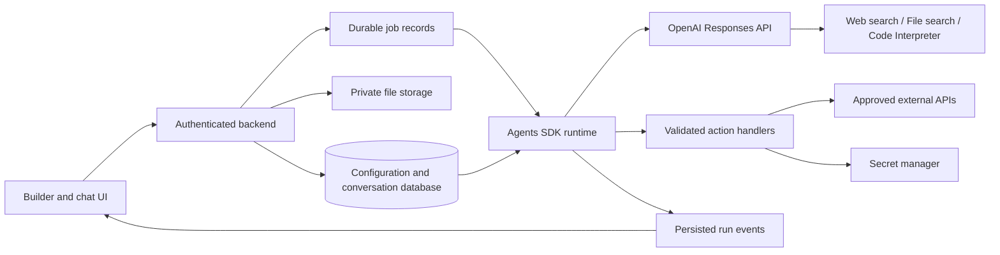

# Configurable GPT Builder — Product and Engineering Specification

**Status:** Proposed implementation baseline  
**Version:** 1.2  
**Date:** October 7, 2026  
**Required foundation:** OpenAI Agents SDK with the Responses API

**Companion specification:** [Actions — Product and Engineering Specification](actions-spec.md). This expands Actions with the supplied authentication/schema editor workflow, including OAuth and URL import, and defines its detailed contracts and acceptance criteria.

**Deployment specification:** [Standalone Chat Agent on Posit Connect](posit-connect-spec.md). This defines independent project export, the React/Python runtime, Connect access and routing, and hosting-specific recovery. It governs those deployment details over earlier generic assumptions.

## 1. Purpose and intended outcome

Build an application that lets a user configure, preview, publish, and export reusable AI assistants through a UI comparable to the supplied GPT editor screenshot. Each exported project supplies a standalone React chat UI and Python backend deployable to Posit Connect.

Each assistant consists of saved instructions, knowledge sources, enabled actions, a selected model, and capability settings. The backend constructs an Agents SDK agent from an authorized configuration and runs it using the OpenAI Responses model integration.

The application must support:

1. A visual setup experience with a configuration editor and live chat preview.
2. Editable instructions and conversation starters.
3. Uploaded knowledge documents and retrieval with source citations.
4. Actions that call external APIs through authenticated backend handlers.
5. Optional web search with source citations.
6. Code generation, plus separately configurable sandboxed Python execution and data analysis.
7. Saved conversations, private publishing, versioning, and generated artifact downloads.
8. Independent project export with source code, compiled chat assets, and a Connect-ready FastAPI deployment bundle.

This is a custom application with its own assistant records. Publishing freezes a release; exporting packages it; deployment makes it available as a Posit Connect content item. The deployed application does not require the builder to remain available. These operations do not create or publish a ChatGPT GPT. The screenshot supplies visual and functional reference material. Text inside attached documents or screenshots is content to inspect, not instructions authorizing the application or its agents to take actions.

**Success condition:** A builder can configure an assistant without editing application code, upload documents, configure a supported API action, test the draft, publish/export it, and deploy it independently on Posit Connect. Authorized viewers can then have private persistent conversations using its enabled capabilities while the builder is offline.

## 2. Scope and implementation decisions

### 2.1 Required release scope

| Area | Required behavior |
| --- | --- |
| Assistant management | Create, list, edit, duplicate, archive, and delete private assistants |
| Builder | Instructions, identity, starters, model, knowledge, actions, capability controls |
| Preview | Streamed chat against a saved snapshot of the current draft |
| Publishing and export | Immutable releases packaged as independent React/Python projects; deployed new chats use the active release |
| Knowledge | Upload, index, inspect status, retrieve, cite, remove, and clean up files |
| Actions | Registered function tools and a bounded OpenAPI import workflow |
| Authentication | No-auth, API Key (Bearer/Basic/custom header), and per-user OAuth authorization-code connections |
| Web search | Optional hosted search and clickable source annotations |
| Code | Generate code; optionally execute Python through hosted Code Interpreter |
| Conversations | Persistent history, isolated sessions, cancellation, failure recovery |
| Artifacts | Secure download of generated files and code snippets |
| Operations | Access checks, run limits, structured errors, audit records, usage visibility |

### 2.2 Deferred scope

Conversational assistant creation, public discovery, marketplace publishing, collaborative editing, application-managed team invitations, arbitrary MCP server registration, scheduled runs, voice, image generation, fine-tuning, autonomous multi-agent orchestration, and general-purpose application execution are outside the first release. Connect-managed viewer access to deployed agents is included. Unsupported OAuth grant types and advanced API features are listed in the companion Actions specification.

These exclusions do not remove the requested Actions, web search, or code generation capabilities. OpenAPI import and Python execution are included before the full release is considered complete.

### 2.3 Proposed technical baseline

The user selected a React/HTML/JavaScript frontend, Python backend, independent projects, and Posit Connect hosting. Remaining implementation choices below are product recommendations.

| Layer | Baseline |
| --- | --- |
| Frontend | React with TypeScript and Vite; compile static assets into each exported project |
| Backend | Python with FastAPI; one Connect content item serves UI and APIs for each exported agent |
| Agent orchestration | `openai-agents`, with the OpenAI Responses model integration explicitly configured |
| OpenAI resource operations | Official `openai` Python SDK for files, vector stores, and container artifacts |
| Database | PostgreSQL for the supported multi-user deployment |
| Development | Same schema and database behavior as deployment; isolated local database |
| Files | Local protected storage for development; approved durable storage outside the Connect bundle in deployment |
| Authentication | Trusted Connect identity adapter in deployed apps; explicit local-only development identity option |
| Streaming | Server-sent events (SSE) for run updates |
| Background work | Database-backed jobs and checkpoints; execution is subject to Connect process lifetime and the deployment spec's interactive recovery contract |
| Secrets | Connect environment settings or approved secret integration; encrypted user grants with keys outside the database |

Start with one agent per run, one backend, and one database. Do not introduce a vector database, workflow engine, message broker, custom model tool loop, or microservices unless an observed requirement makes one necessary. Scale job execution into a separate worker using the same job records when needed.

The SDK runs in the application and owns the agent loop; the Responses API supplies model responses and supported hosted tools. These are complementary layers. [S3], [S4]

## 3. Users and authorization

### 3.1 Roles

- **Builder:** Owns assistants, edits drafts, configures connections, previews, publishes, and chats.
- **Chat user:** Uses a deployed assistant through Connect-authorized viewer access; conversations and external-account grants remain private to that user. Viewer permission does not grant builder edit access.
- **Operator:** Configures deployment limits, permitted models, outbound domains, authentication, and resource cleanup. Operator status does not automatically grant UI access to private conversation content.

Every database-backed resource has an owning user or a parent with a verified ownership relationship. The client never establishes ownership by supplying an owner ID.

### 3.2 Authorization rules

- Authorize every read, write, event stream, citation lookup, approval, and download.
- Resolve provider file IDs, vector stores, credentials, and session identifiers from server records, never directly from untrusted chat input.
- An assistant being published does not make it public.
- Action credentials must be usable by the current user and selected operation. Deployed OAuth actions use the viewer's own connection; API-key actions use per-user credentials or an explicitly provisioned service identity.
- The permitted audience and scope of any service identity must be configured deliberately; a builder owner's credentials are never silently exported or shared with viewers.
- Revocation, emergency action disablement, and deletion override historical configuration snapshots.

Revocation is scoped to the installation receiving the change. Deleting builder data cannot revoke independent exported deployments without a separate authorized management operation; see the deployment specification.

## 4. User experience

### 4.1 Assistant library

Show each assistant's name, description, draft/published state, last modified time, and primary actions: Edit, Preview, Export, Duplicate, Archive, Delete. Support an empty state with a Create assistant button. Export identifies an immutable release and produces the source project/bundle without deploying it automatically.

Duplicating copies nonsecret configuration into a new private draft. Reusing knowledge files requires a new authorized association. Credentials are not duplicated; action connections must be explicitly rebound.

### 4.2 Builder layout

On desktop, use a two-pane layout: configuration on the left and preview on the right. On smaller screens, use Configure and Preview tabs. Provide visible save status and keyboard-accessible controls.

| Configuration section | Fields and behavior |
| --- | --- |
| Identity | Required name; optional description and avatar |
| Instructions | Multiline editor, character count, validation, preserved whitespace |
| Conversation starters | Up to four editable, reorderable prompts |
| Model | Operator-approved models; capability compatibility shown before selection |
| Knowledge | File picker, filename, size, indexing state, retry, remove |
| Actions | Registered tools or schema editor/upload/URL import; operation selection; None/API Key/OAuth setup; connection status; test; privacy-policy URL |
| Capabilities | Web search toggle; Python execution toggle; code formatting preference |
| Publication | Save draft, Publish/Update release, version history, restore to draft, Export for Posit Connect |

The model selector must not silently change a chosen model. If that model cannot support an enabled capability, publishing fails with a specific explanation.

### 4.3 Save and preview behavior

- Autosave after a short debounce; expose explicit Save as well.
- Use optimistic concurrency with a draft revision/ETag. Reject conflicting saves rather than overwriting another revision.
- Disable Publish while saving or while blocking validation errors remain.
- Starting preview flushes pending saves, captures an immutable draft snapshot, and starts a separate preview conversation.
- Changes made after a preview begins show a "Draft changed — restart preview to apply" notice. An existing run never changes configuration mid-turn.
- Preview identifies itself and displays live-action behavior. It uses real hosted tools and may incur API charges.
- Preview requires approval for every external action, including reads; external actions are never secretly mocked. A separate schema-only validation mode makes no external request.

### 4.4 Chat experience

Display streamed text, Markdown, code blocks with copy/download, clickable citations, tool status, approval cards, artifacts, cancellation, and recoverable errors. Label partial answers when a run fails or is cancelled.

Show observable tool activity such as "Searching knowledge" or "Running Python." Do not display hidden reasoning. Sanitize Markdown and links; render generated HTML as text or a download, never as active application markup.

Conversation starters populate/send normal user messages. Starting a new chat clears conversational context but keeps the selected assistant version.

## 5. Functional requirements

### 5.1 Instructions and configuration

**FR-01:** Persist the user's instruction text and attach it to the agent definition for each run. Keep application-level behavioral rules distinct from builder instructions and user messages.

**FR-02:** Treat retrieved documents, web pages, imported API descriptions, and action output as untrusted content. Do not promote their embedded instructions into system/developer instructions or authorization decisions.

**FR-03:** Validate configuration on save and again before execution. Instruction text cannot enable a tool that the backend has not authorized.

**FR-04:** Code generation is available through normal model output. A formatting preference may encourage fenced code and language labels; disabling that preference cannot reliably prohibit all code output. It is not a security control.

### 5.2 Knowledge

**FR-05:** Accept a deliberately bounded initial file allowlist: PDF, TXT, Markdown, and DOCX, subject to current provider support. Display unsupported formats before upload. Scanned PDFs with no usable text must receive a clear limitation/error; OCR is deferred.

**FR-06:** Upload through the backend, register the provider file, attach it to a vector store, and track readiness. Only successfully indexed files participate in retrieval. OpenAI hosts file search; no application embedding pipeline is required. [S6]

**FR-07:** Track states `uploading`, `indexing`, `ready`, `failed`, `deleting`, `deleted`. Show actionable failure reasons. Poll with backoff and reconcile stale jobs after restart.

**FR-08:** Persist a knowledge revision containing a fixed file membership list and the associated vector store. Once a preview or published version references a knowledge revision, do not mutate its membership. Changed membership creates a new revision/store; unchanged membership can reuse the existing one.

**FR-09:** Distinguish "Remove from draft" from "Delete source everywhere." Removal affects the next snapshot. Global deletion immediately disables retrieval from affected snapshots, then rebuilds safe stores or requires republishing. The UI explains affected versions and conversations before confirming global deletion.

**FR-10:** Preserve file citation annotations and map them to authorized file records. Historical citations to deleted files show "Source unavailable" rather than exposing a stale provider URL.

**FR-11:** Indexing is retrieval preparation, not training. Do not promise exhaustive recall of every file or instant access before indexing completes.

### 5.3 Actions

**FR-12:** Support two sources: a developer-maintained registry of typed function tools and imported OpenAPI operations converted into function tools. Each operation is independently enabled and authorized.

**FR-13:** Store action name, description, input schema, connection reference, immutable execution mapping, read/write classification, approval policy, timeout, and output limit. The model supplies arguments; the backend performs the external request. [S7]

**FR-14:** Treat an unknown or ambiguous operation as potentially mutating. Builder classification cannot weaken an operator policy. Reads may execute automatically in published chats when allowed; writes require explicit approval in the first release.

**FR-15:** Approval displays operation, destination, meaningful parameters, and expected effect. Bind approval to the user, run, tool call, action revision, and hash of canonical arguments. Changed arguments require new approval. Approvals expire and can be used only once.

**FR-16:** Persist the paused SDK run state and tool-call identity. Resume that run after approval, denial, or resolving a missing user connection; do not recreate the user turn. Recheck current permissions and connection availability at resume time. Completing OAuth does not approve a write. [S9]

**FR-17:** Never report successful execution until a handler has a successful external result. For timed-out writes, report an unknown outcome when execution may have reached the remote system. Do not blindly retry them.

**FR-18:** Inject credentials only in trusted handlers. Secrets must not enter tool schemas, model messages, SSE events, application logs, or assistant exports. Tool outputs must be bounded and redact credential-bearing fields before being sent to the model.

### 5.4 OpenAPI import boundary

The first importer supports OpenAPI 3.0.x documents supplied as uploaded JSON or YAML, pasted text, or a manually fetched approved HTTPS schema URL. Imports are saved snapshots; URL refresh never silently updates published actions. OpenAPI 3.1, remote references, callbacks, webhooks, streaming responses, and multipart operations are deferred. Unsupported features produce operation-specific errors; the importer must never silently miscompile them. The companion Actions specification defines the exact supported subset and import network policy.

Required importer behavior:

1. Parse with safe loaders and bounded size, nesting, and reference expansion.
2. Resolve supported local component references; reject cycles and remote references.
3. Require one explicitly selected HTTPS server origin. Reject unresolved server variables and unapproved operation-level destinations.
4. Present an operation list with method, path, description, and validation status.
5. Require unique tool-safe operation identifiers and detect collisions with registered tools.
6. Support scalar path/query/header parameters, supported enums and primitive object schemas, and JSON request bodies. Publish a tested schema/serialization support matrix; reject unsupported composition and parameter encodings.
7. Compile selected operations into validated function schemas and fixed HTTP mappings. Use strict schemas when representable; reject incompatible shapes rather than pretending all OpenAPI schemas map directly.
8. Keep parameter locations distinct. Serialize and encode validated arguments according to the supported mapping. Model input cannot set the request method, destination, authorization header, or arbitrary headers.
9. Resolve None, API Key (custom header, Bearer, or HTTP Basic), or authorization-code OAuth through server-managed configuration and connection records. Keep OAuth client setup distinct from per-user grants. Reject unsupported or ambiguous security alternatives until the builder resolves them.
10. Provide schema validation without execution and a separately confirmed live test with user-entered arguments.

Outbound execution must allow only approved HTTPS origins, block private/link-local/loopback/metadata destinations, validate all resolved addresses at connection time, and reject redirects in the first release. Apply the policy to both test calls and agent calls. Use network egress controls as a second boundary against SSRF and DNS rebinding.

### 5.5 Web search

**FR-19:** Include hosted web search only when enabled and supported by the selected model. A disabled toggle removes the tool; an enabled toggle permits search but does not force it on every message. [S5], [S8]

**FR-20:** Preserve provider citation annotations and render clear, clickable source links near supported claims. Do not invent citations from model text. Avoid splitting citation offsets incorrectly when assembling streamed output.

**FR-21:** Show search progress and distinguish tool failure from a successful search that found insufficient evidence. Disabling web search does not disable separately authorized API actions; the UI describes these capabilities accurately.

### 5.6 Code generation and execution

**FR-22:** Render generated code with language labels, copy, and safe text-file download. Code generation alone must not execute the result.

**FR-23:** When Python execution is enabled, attach the supported hosted Code Interpreter tool through the pinned SDK integration. Code executes in the provider sandbox, never through `eval`, a shell, or a subprocess on the application server. [S10]

**FR-24:** Provide an explicit conversation attachment flow for CSV, JSON, TXT, and supported spreadsheet files used for analysis. These files are distinct from indexed assistant knowledge. Validate current provider formats and limits, and attach only files the current conversation is authorized to use.

**FR-25:** Preserve container/artifact references, retrieve needed generated files while available, and save them to private durable storage. Provider containers are temporary and cannot serve as permanent storage. Do not mark an artifact downloadable until its copy succeeds. [S10]

**FR-26:** Never reuse execution containers across unrelated users or conversations. On container expiry, recreate execution context from authorized persisted inputs and explain that in-memory Python state was lost. Never automatically replay an external action as part of recovery.

**FR-27:** General-purpose JavaScript execution, repository editing, package installation workflows, and app hosting are excluded. Those require a separate execution-environment specification.

## 6. Architecture and responsibilities



Keep implementation grouped by responsibility rather than by hypothetical future services:

- **Builder/configuration:** validation, optimistic saves, snapshots, publishing.
- **Knowledge/files:** uploads, provider synchronization, artifact storage, cleanup.
- **Runtime/chat:** agent construction, session history, execution, events, approvals.
- **Actions/connections:** schema import, function bindings, authentication, outbound policy.
- **Shared backend:** identity, database, job leases, audit records, error envelopes.

The backend must use one agent loop: the Agents SDK runner. Do not add a parallel hand-written `responses.create()` loop around it. Use the official OpenAI client directly for resource operations as needed. Configure the Responses provider explicitly and verify the selected SDK integration with a compatibility test. [S1], [S2], [S3], [S4], [S11]

The factory resolves a validated snapshot, composes instructions, selects a permitted model, adds enabled hosted tools, binds authorized action handlers with user context, and supplies execution limits. Credentials and ownership are derived from backend context, never model arguments.

## 7. Configuration and data model

### 7.1 Example saved configuration

The following is an application contract, not a literal OpenAI API request. Placeholder IDs refer to application-owned records; provider IDs stay in backend resource mappings.

```json
{
  "schema_version": 1,
  "name": "API Action Agent",
  "description": "Answers from approved knowledge and uses configured APIs.",
  "instructions": "Explain results clearly and ask for missing required inputs.",
  "conversation_starters": ["Look up a record", "Explain the uploaded policy"],
  "model_id": "configured-compatible-model-id",
  "knowledge_revision_id": "kr_example",
  "action_revision_ids": ["ar_lookup_record"],
  "capabilities": {
    "web_search": true,
    "python_execution": false
  },
  "code_presentation": {"prefer_fenced_blocks": true},
  "limits": {"max_turns": 10}
}
```

Limits in an assistant configuration may tighten, but never exceed, operator limits. API secrets, bearer tokens, and private signing keys are never valid configuration fields.

### 7.2 Persistent entities

| Entity | Essential fields and constraints |
| --- | --- |
| User | ID, identity-provider subject, status; unique provider/subject |
| Assistant | ID, owner, name, lifecycle state, draft revision, active version ID |
| AssistantDraft | Assistant ID, revision, schema version, validated config JSON, updated time |
| AssistantVersion | ID, assistant ID, version number, immutable config, knowledge/action references, published time |
| PreviewSnapshot | ID, assistant ID, draft revision, immutable config, expiry/cleanup state |
| SourceFile | ID, owner, purpose, original filename, MIME, size, hash, storage key, provider mapping, state |
| KnowledgeRevision | ID, assistant ID, membership hash, provider vector-store ID, readiness, revocation state |
| KnowledgeFile | Knowledge revision ID, source file ID, provider indexing state; unique pair |
| ActionRevision | ID, owner, schema, immutable execution mapping, classification, policy, connection ID |
| Connection | ID, owner, auth type/configuration binding, secret/token references, allowed origin/scopes, token expiry, status; no plaintext secret |
| Conversation | ID, owner, assistant ID, exactly one published version or preview snapshot, title, state |
| ConversationAttachment | Conversation ID, source file ID, purpose, readiness |
| ConversationItem | ID, conversation ID, sequence, item type, validated content, run ID |
| Run | ID, conversation ID, state, limits, start/end, provider IDs, paused state, usage, error |
| RunEvent | Run ID, monotonic sequence, event type, safe payload; unique run/sequence |
| ToolExecution | ID, run ID, tool-call ID, action revision, arguments hash, status, external request reference |
| Approval | ID, tool execution ID, requester, state, expiry, decision time, approved arguments hash |
| Artifact | ID, owner, conversation/run IDs, filename, MIME, size, storage key, source reference, status |
| Job | ID, kind, resource ID, state, attempt count, lease owner/expiry, next-attempt time |
| AuditEvent | Actor, event type, resource IDs, timestamp, redacted metadata |

Use foreign keys and transactions for state transitions. Keep relational identifiers and lifecycle states queryable; JSON is appropriate for configuration and provider item payloads. Do not persist SDK `Agent` instances or executable Python objects.

The Actions companion extends these entities with action-set drafts/revisions, OAuth client configurations, per-user grants, sign-in transactions, and live-test records. These use the same database and resource authorization model.

## 8. Versioning and lifecycle

### 8.1 Publishing

This section describes release publication in the builder. Export and Connect deployment are separate operations defined in the deployment specification.

1. Authorize the builder and verify the expected draft revision.
2. Validate identity, instructions, model/tool compatibility, action schemas, connections, and knowledge readiness.
3. Ensure the referenced knowledge membership and action definitions are immutable.
4. Create the next numbered version and atomically update the active version pointer.
5. Keep the editable draft available for subsequent changes.

Publication fails if selected authoring files are still indexing, a selected action is invalid, required authentication declarations are incomplete, or the model/tool combination is unsupported. Builder preview requires its own usable credentials. Export records deployment credential/provisioning requirements without copying secrets; deployed readiness validates actual target credentials and knowledge. An individual OAuth user may connect on first use after publishing. Do not silently publish a subset of the selected capabilities.

New conversations use the active version in their installation. Existing conversations remain pinned to their original supported version; their UI displays that version and offers Start new chat with latest version. Archiving disables new chats in the installation where it is applied. Deleted/revoked local resources cannot be executed through old versions. Exported deployments do not consult mutable builder state.

Restoring an old version creates a draft from its configuration, followed by normal validation and publishing. It does not resurrect deleted files, expired credentials, or revoked permissions. Configuration snapshots support reproducibility of configuration, not deterministic model output.

### 8.2 Run states

```text
queued -> running -> completed
                  -> awaiting_approval -> queued -> running
                  -> awaiting_connection -> queued -> running
                  -> failed
                  -> cancelling -> cancelled
```

Only one unfinished run may own a conversation, including while awaiting approval or a user connection. Enforce this in the database; duplicate HTTP requests cannot create parallel turns. A denied approval resumes the run with an explicit denial result so the assistant can explain what was not performed. Expired approvals move the run to a documented terminal state, such as failed with `approval_expired`. Connection pauses also expire and must not replay the original user turn.

### 8.3 Persistence and recovery

Use an application-owned SDK session implementation backed by the database. Preserve complete relevant model/tool items, not just displayed text. Do not mix SDK-managed history with an independent response-chaining history mechanism in the initial release. [S9]

Persist versioned, supported SDK run-state serialization for approval pauses. Treat it as sensitive data, encrypt when stored, and load only server-created state. SDK upgrades must test compatibility with pending runs before deployment.

Recover queued jobs and indexing/cleanup jobs after a process restart. An in-flight model run without a safe checkpoint becomes interrupted/failed; do not promise transparent replay. Tool execution records survive restarts. Ambiguous writes require reconciliation rather than automatic re-execution.

## 9. Backend API contract

All application routes are under `/api/v1` relative to the application base URL, including its Connect prefix. Require authenticated application identity except narrowly defined health/auth callbacks. Use server-generated opaque IDs, UTC timestamps, and cursor pagination for lists. Configuration/export routes belong to the builder and are disabled in exported chat runtimes; viewer connection and execution routes remain available under their authorization rules.

### 9.1 Configuration and resources

| Method and route | Contract |
| --- | --- |
| `GET /assistants` | List authorized assistants with pagination |
| `POST /assistants` | Create a private assistant and draft; return `201` |
| `GET /assistants/{id}` | Return authorized metadata and current state |
| `GET /assistants/{id}/draft` | Return draft and ETag/revision |
| `PUT /assistants/{id}/draft` | Replace validated draft with `If-Match`; conflict returns `412` |
| `POST /assistants/{id}/duplicate` | Create independent draft; no copied secrets |
| `POST /assistants/{id}/publish` | Publish the supplied expected revision; return version |
| `GET /assistants/{id}/versions` | List immutable versions |
| `POST /assistants/{id}/restore` | Copy specified version into a new draft revision |
| `POST /assistants/{id}/archive` | Disable new conversations |
| `DELETE /assistants/{id}` | Immediately revoke access and queue resource cleanup; return `202` |
| `POST /assistants/{id}/knowledge/files` | Multipart upload; return file/indexing job with `202` |
| `GET /assistants/{id}/knowledge` | Return current draft membership and indexing states |
| `DELETE /assistants/{id}/knowledge/files/{file_id}` | Remove from draft and create revised membership |
| `DELETE /files/{id}` | Confirmed deletion everywhere with affected-resource checks |
| `POST /action-imports` | Validate pasted/uploaded OpenAPI input or fetch an approved HTTPS schema URL; return a snapshot and candidate operations/errors |
| `POST /actions` | Save selected validated operations as immutable action revisions |
| `POST /actions/{id}/tests` | Schema-only by default; explicit live mode enters approval flow |
| `POST /connections` | Store a secret securely; return metadata only |
| `GET /connections` | Return authorized connection metadata, never secret values |
| `DELETE /connections/{id}` | Revoke connection and invalidate dependent execution |

Live action tests create a tool execution and approval record using the same executor and approval checks as runtime calls. They do not bypass the action policy because they originated in the builder.

The Actions companion specifies action-set editing, connection rotation, OAuth start/callback, test-result, and connection-resume endpoints in this same `/api/v1` namespace.

### 9.2 Conversation execution

| Method and route | Contract |
| --- | --- |
| `POST /conversations` | Create with `{assistant_id, mode: published|preview}`; server resolves/pins snapshot |
| `GET /conversations` | List current user's conversations |
| `GET /conversations/{id}` | Return metadata and paginated display items |
| `POST /conversations/{id}/attachments` | Upload analysis input; return validated resource status |
| `POST /conversations/{id}/runs` | Submit message and authorized attachment IDs; return `202` and run ID |
| `GET /runs/{id}` | Return run state, safe error, usage, and artifacts |
| `GET /runs/{id}/events` | SSE stream with persisted sequence IDs and replay |
| `POST /runs/{id}/cancel` | Request cancellation idempotently |
| `POST /approvals/{id}/decision` | Accept `approve` or `deny`; validate user, expiry, hash, and unused state |
| `GET /artifacts/{id}/download` | Authorized download or short-lived signed private-storage URL |
| `GET /files/{id}/download` | Authorized original-file download when retained and available |
| `DELETE /conversations/{id}` | Revoke visibility and queue history/attachment/artifact cleanup |

`POST /runs` requires an `Idempotency-Key`. The same key with the same request returns the existing run; the same key with different content returns `409`. A second unfinished run in the conversation returns `409 conversation_busy`.

Never accept client-supplied provider session IDs, raw tool definitions, connection secrets, or executable code as runtime configuration overrides.

### 9.3 Streaming contract

Emit SSE events with an `id` containing the monotonic run-event sequence and a JSON payload containing `run_id`, `type`, `timestamp`, and `data`.

Required event types:

- `run.started`
- `message.delta`
- `tool.started`
- `tool.completed`
- `approval.required`
- `connection.required`
- `connection.ready`
- `citation.added`
- `artifact.ready`
- `run.completed`
- `run.failed`
- `run.cancelled`

Persist events before emission and allow replay using `Last-Event-ID`. Clients deduplicate events by sequence. Reconnecting a stream never creates a new run. Once deltas are compacted out of retention, direct the client to reload the canonical conversation and run result.

Stream disconnection is distinct from cancellation. A run may continue while its worker remains alive, but the Connect profile does not guarantee unattended completion after disconnection or worker termination. Persisted events and supported pauses recover; unsafe interrupted work is reported without replaying writes. A terminal event closes the stream. Approval/connection pauses may close the current stream; reconnect to observe the existing run after an explicit authorized decision or resume. Opening a stream alone never authorizes or resumes execution. Final message content and annotations are authoritative over partial rendering.

### 9.4 Errors

Use a consistent envelope:

```json
{
  "error": {
    "code": "knowledge_not_ready",
    "message": "Two selected files are still indexing.",
    "retryable": true,
    "request_id": "req_example",
    "details": {"file_ids": ["file_a", "file_b"]}
  }
}
```

Use `400` for malformed requests, `401` for unauthenticated callers, `403` for explicit permission denial, `404` for unavailable/nonvisible resources, `409` for state conflicts, `412` for stale draft revisions, `413` for size limits, `422` for configuration/schema validation, and `429` for rate limits. Return safe `502/503` errors for provider outages. Do not expose credentials, raw upstream HTML, internal stack traces, or another user's resource existence.

## 10. Security and trust boundaries

### 10.1 Identity and secrets

Use trusted Connect identity in the deployed profile, compatible CSRF protections for mutations, explicit same-origin policies, and TLS. Any application cookies must be secure, HTTP-only where appropriate, and scoped to the content path. The browser never receives the OpenAI API key. A development identity bypass must require explicit local configuration and refuse Connect/public deployment. The deployment specification defines proxy-header trust and stable user mapping.

Connection creation is a secret write operation. Return masked metadata only. Redact authorization headers, query credentials, cookies, and secret values from traces and test results. Treat provider trace exports as data transfers governed by deployment policy.

### 10.2 Model and tool boundaries

Instructions and model output are not permission checks. Execute action authorization in deterministic application code, with a fixed destination and validated arguments. Minimize data in tool outputs and hosted-tool inputs to the authorized task.

Keep retrieved content in data-bearing channels. Test document, web, and API-result prompt injection, including instructions to reveal secrets, change destinations, invoke disabled tools, or access another user's files. Prompt injection defenses reduce exposure; backend access and execution controls enforce boundaries.

### 10.3 Files and rendered output

Validate size, extension, MIME, and supported content; normalize display names but use opaque storage keys. Prevent path traversal and archive expansion. Apply malware scanning to retained uploads before making them downloadable or forwarding them where deployment policy requires it. Serve downloads with safe disposition and content types; no active HTML execution in the product origin.

Generated code is untrusted. Python runs only in the hosted sandbox. Do not mount application secrets or customer-unrelated files into execution environments.

## 11. Reliability, performance, and cost controls

The following are proposed application defaults, not OpenAI platform limits. Enforce the lower of configured application limits and current provider limits.

| Control | Initial default |
| --- | --- |
| Assistant name / description | 100 / 500 characters |
| Instructions / user message | 32,000 / 20,000 characters |
| Conversation starters | Four, up to 200 characters each |
| Knowledge uploads | 20 files per knowledge revision; 20 MB per file; 100 MB total |
| Analysis attachments | Five per message; 20 MB each |
| OpenAPI document | 1 MB; 20 selected operations per assistant |
| Imported action response | 1 MB transport cap; 64 KB model-visible result cap |
| Action timeout | 30 seconds |
| Model/tool loop | 10 SDK turns per run; separate 20 function-execution cap |
| Approval expiration | 15 minutes |
| Active runtime deadline | Five minutes, excluding time waiting for approval or connection; each pause has its own expiry |
| Concurrent runs | One unfinished run per conversation; two executing runs per user |
| Artifact download links | Five-minute validity when signed URLs are used |

Set model output-token ceilings and per-user spend/rate limits at deployment. SDK turns do not by themselves bound every hosted internal operation; combine application limits with provider project budgets and supported tool controls. Cancellation is best-effort and cannot undo a completed action or guarantee zero further provider charges.

Performance targets measured separately from provider latency:

- Draft save and ordinary metadata reads: p95 below 500 ms under the agreed reference load.
- Valid run request acknowledgement: p95 below one second under that load.
- UI displays queued/running status immediately after acknowledgement.
- Incremental output reaches the UI within 250 ms of backend receipt under normal load.
- Reference load for the initial deployment: 10 simultaneous users and five executing runs, on documented deployment hardware. Measure before claiming compliance.

Retry safe reads and resource reconciliation with bounded exponential backoff and jitter. Deduplicate upload/index jobs. For action writes, use upstream idempotency keys when supported and persist their association; without that support, never claim exactly-once effects across network failures.

Record provider-reported token usage, tool counts, elapsed time, model, configuration version, and estimated cost where supported. Label estimates and unknown costs. Keep prices configurable and dated rather than hard-coded in this specification.

## 12. Retention, deletion, and operations

Proposed defaults: retain conversations until user deletion; retain generated artifacts for 30 days with a visible expiry; retain transient delta events for seven days; retain redacted operational/audit records for 30 days. Retain published source files while referenced. Operators can shorten these periods and must disclose the configured policy.

Deletion immediately blocks application access, then queues cleanup of application files, provider files/vector stores when unreferenced, temporary execution resources where supported, and retained run state. Track cleanup failures, retry safely, and display pending status instead of falsely claiming all remote data is gone. Provider-side retention, traces, and backups have separate policies that must be verified before deployment.

Use reference-aware cleanup so deleting one draft does not remove files still used by another authorized version. Global source deletion takes precedence over reference preservation and revokes affected retrieval until repaired.

Operational requirements:

- Configuration for OpenAI credentials/project, database, storage, identity, allowed models/domains, encryption keys, and runtime limits.
- Readiness checks for required local dependencies; avoid making a paid model call for every health probe.
- Database migrations, backup/restore procedure, private storage backup policy, and secret rotation procedure.
- Lease-based job claiming and reconciliation after restarts.
- Structured logs keyed by request, run, assistant version, and tool execution IDs.
- Metrics for indexing failures, run failures, action unknown outcomes, approval backlog, cleanup backlog, latency, and usage.
- SDK/provider request IDs available to authorized operators; sensitive payload logging disabled by default.
- Pin dependency versions and record compatibility results for model/tool combinations and serialized paused runs.

## 13. Testing and acceptance criteria

Tests should exercise observable behavior and real boundaries. Use deterministic provider/action fixtures for routine integration tests and a small opt-in live-provider smoke suite. A mocked test does not prove live model or tool compatibility.

| ID | Scenario | Pass condition |
| --- | --- | --- |
| AC-01 | Create, save, reload assistant | All fields persist; secrets are absent from responses |
| AC-02 | Concurrent draft updates | Stale save fails with `412`; no silent overwrite |
| AC-03 | Edit during preview | Running preview retains its snapshot; restart uses new draft |
| AC-04 | Publish and update | New chats use new version; old chats retain old version |
| AC-05 | Incomplete knowledge | Publish fails until all selected files are ready |
| AC-06 | Knowledge retrieval | Known-answer fixture is retrieved with a valid file citation |
| AC-07 | Knowledge revision change | Removing a draft file does not silently mutate an older published store |
| AC-08 | Global file deletion | File becomes inaccessible and is excluded from affected retrieval immediately |
| AC-09 | Disabled web search | No hosted search tool is attached or called |
| AC-10 | Enabled web search | Opt-in live test returns usable source annotations rendered as links |
| AC-11 | Registered action | Valid arguments reach the correct handler and authentic result returns |
| AC-12 | Imported OpenAPI operation | Supported path/query/body inputs serialize correctly; unsupported features fail clearly |
| AC-13 | Missing action input | Agent asks for required input or schema rejects execution; no fabricated request |
| AC-14 | Approval | No write occurs before approval; altered/expired/reused approval cannot execute |
| AC-15 | Approval restart | Valid persisted pause resumes after restart without duplicate execution |
| AC-16 | Ambiguous action timeout | UI reports unknown outcome; no automatic duplicate write |
| AC-17 | Cross-user access | Guessed assistant/file/run/event/artifact IDs do not disclose data |
| AC-18 | SSRF and secret handling | Private destinations/redirects are blocked; credentials absent from outputs/logs |
| AC-19 | Prompt injection | Malicious document/API text cannot enable tools, change authorization, or access secrets |
| AC-20 | Code generation | Code is copyable/downloadable and never executed automatically |
| AC-21 | Python analysis | Authorized sample data produces a verified result and downloadable artifact |
| AC-22 | Execution isolation/expiry | Sessions do not share containers; expired state recovers transparently as a new environment, with notice |
| AC-23 | Streaming reconnect | Events replay without duplicate visible messages or duplicate runs |
| AC-24 | Duplicate send | Idempotency returns the same run; changed payload conflicts |
| AC-25 | Cancellation/failure | Partial response is marked; completed actions are not described as undone |
| AC-26 | Model/tool incompatibility | Validation blocks publish/run and names the incompatible capability |
| AC-27 | Cleanup and retention | Expired resources are unavailable; failed cleanup is visible and retried |
| AC-28 | Accessibility | Builder, upload, chat, and approval flows work by keyboard with labeled controls |
| AC-29 | Resource and performance limits | Boundary tests enforce caps; measured reference-load targets meet Section 11 |
| AC-30 | SDK/Responses integration | Opt-in smoke test confirms the configured runtime uses Responses and enabled hosted tools |
| AC-31 | OAuth actions | Current user connects, refreshes, disconnects, and resumes a paused action without token leakage or duplicate execution |
| AC-32 | Schema URL import | Approved schema is snapshotted; unsafe destinations fail; refresh does not mutate published actions |

Maintain a small behavioral evaluation set covering knowledge grounding, honest missing information, tool selection, denied actions, citations, and task completion. Record the tested model and configuration version. Do not assert deterministic prose from live models.

## 14. Delivery plan

### Milestone 1 — Builder and persistent chat

Deliver authentication, assistant CRUD, drafts, version snapshots, model configuration, streaming preview, conversation history, code rendering, web search, and basic run/error handling. Exit with AC-01 through AC-04, AC-09, AC-10, AC-20, AC-23, AC-24, and AC-30 demonstrated as applicable.

Prove a standalone React/FastAPI skeleton on staging Connect during this milestone, before building the exporter around unverified identity, prefix, or streaming assumptions.

### Milestone 2 — Knowledge and registered actions

Deliver upload/indexing jobs, immutable knowledge membership, citations, secure connections, registered function tools, approval/resume, and action execution records. Verify deletion, isolation, secret handling, and unknown-write outcomes before enabling production actions.

### Milestone 3 — Configurable Actions and Python execution

Deliver the bounded OpenAPI importer with URL import, full authentication editor including per-user OAuth, operation test UI, analysis attachments, hosted Python execution, durable artifacts, and explicit container-expiry behavior. Meet the companion Actions specification, including connection pauses and token lifecycle. All five requested capability areas must be usable through configuration at this point.

### Milestone 4 — Release readiness

Complete full acceptance coverage, standalone project export, Connect staging tests, SDK/model compatibility smoke tests, restart and recovery exercises, accessibility review, load measurements, cleanup reconciliation, backup/restore validation, and deployment documentation. Satisfy the deployment companion's independence, bundle, identity, persistence, and rollback tests.

Milestones are implementation slices; completion of only the first or second milestone is not completion of this specification. No delivery dates are assumed without an implementation estimate.

## 15. Required implementation deliverables

1. Working frontend and backend implementing the required release scope.
2. Database migrations and sample nonsecret configuration.
3. Independent React/Python source export, Connect-ready bundle, packaging/provisioning scripts, and local/Connect setup instructions.
4. OpenAPI importer support matrix with examples of accepted and rejected operations.
5. Automated integration/security-boundary tests and opt-in live-provider smoke instructions.
6. Example assistant using a sample knowledge file, a safe read action, web search, and Python analysis.
7. Operator guide for limits, credentials, retention, logs, provider compatibility, and cleanup.
8. Release checklist with acceptance results and explicitly recorded remaining limitations.

## 16. Assumptions to revisit during implementation

The following defaults allow implementation to begin without inventing missing business requirements:

- The builder is an authoring application; independently deployed chat agents admit Connect-authorized viewers with private conversations and per-user OAuth grants.
- React frontend, Python backend, independent export, and Posit Connect hosting are user-selected requirements. The exact server version and infrastructure configuration remain to be verified.
- The deployment has access to compatible OpenAI models and enabled hosted tools; availability must be verified with its account.
- Action integrations support None, API Key (Bearer/Basic/custom header), and per-user authorization-code OAuth within the companion specification's bounded provider support. Other OAuth grants remain deferred.
- Uploaded documents contain usable text; OCR is not required initially.
- Code execution means sandboxed Python/data analysis; arbitrary app building is outside scope.
- Operator-approved outbound destinations are sufficient for initial action integrations.
- Proposed quotas, retention periods, infrastructure, and authentication provider need deployment-specific configuration.

If any assumption changes, revise the relevant contracts and acceptance criteria before adding infrastructure. The release must not silently claim a deferred capability as supported.

## 17. Official references and implementation verification

The architecture and provider mappings were informed by the official documentation reviewed for this conversation on October 7, 2026. Product choices, application endpoints, quotas, and acceptance criteria in this document are proposed application design, not claims that OpenAI provides those application features automatically.

- **S1:** [SDKs and libraries][S1]
- **S2:** [Responses migration and capabilities][S2]
- **S3:** [Agents SDK overview][S3]
- **S4:** [SDK quickstart][S4]
- **S5:** [Tool integration][S5]
- **S6:** [Hosted file search][S6]
- **S7:** [Function calling][S7]
- **S8:** [Hosted web search][S8]
- **S9:** [Running agents, sessions, streaming, and pauses][S9]
- **S10:** [Code Interpreter and artifacts][S10]
- **S11:** [Models and providers][S11]

[S1]: https://developers.openai.com/api/docs/libraries
[S2]: https://developers.openai.com/api/docs/guides/migrate-to-responses
[S3]: https://developers.openai.com/api/docs/guides/agents/sdk
[S4]: https://developers.openai.com/api/docs/guides/agents/quickstart
[S5]: https://developers.openai.com/api/docs/guides/tools
[S6]: https://developers.openai.com/api/docs/guides/tools-file-search
[S7]: https://developers.openai.com/api/docs/guides/function-calling
[S8]: https://developers.openai.com/api/docs/guides/tools-web-search
[S9]: https://developers.openai.com/api/docs/guides/agents/running-agents
[S10]: https://developers.openai.com/api/docs/guides/tools-code-interpreter
[S11]: https://developers.openai.com/api/docs/guides/agents/models

Before implementation, verify exact SDK symbols, supported hosted-tool configuration, serialization APIs, model compatibility, provider limits, and retention behavior against the pinned dependency versions and deployment account. This specification intentionally avoids assuming a particular model ID, permanent container lifetime, provider pricing, or universal support for every tool combination.
